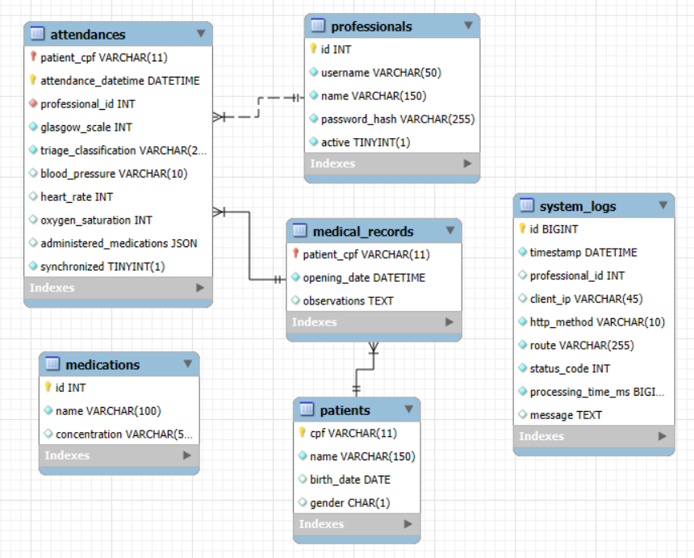

# MedicalField API

Arquitetura desenvolvida para o sistema **MedicalField**, integrando gestão clínica, geração de documentos/notificações e auditoria de requisições.

## Arquitetura e Serviços

O repositório centraliza os três serviços que compõem o backend da aplicação:

* **API Principal (`/` - Raiz):** Desenvolvida em **Java (Spring Boot)**. Responsável pelas regras de negócio, autenticação (Spring Security), portal web (Thymeleaf), endpoints REST e integração com o banco de dados MySQL.
* **Serviço de Documentos e E-mail (`/medicalfield_pdf_email`):** Desenvolvido em **Node.js** com **Puppeteer**. Responsável pela renderização de relatórios em PDF e disparo de e-mails.
* **Serviço de Auditoria (`/medicalfield_logging`):** Desenvolvido em **Python (Flask)**. Recebe assincronamente os dados das requisições da API principal e persiste os logs.

## Acesso ao Ambiente em Produção (VM)

O sistema encontra-se implantado e disponível para testes no servidor em nuvem:
* **Portal Web:** [http://177.44.248.67:8080/medicalfield](http://177.44.248.67:8080/medicalfield)
* **Documentação da API (Swagger):** [http://177.44.248.67:8080/swagger-ui.html](http://177.44.248.67:8080/swagger-ui.html)

## Diagramas do Sistema

### Arquitetura de Microsserviços

### Modelagem do Banco de Dados
